# AppliedSwatches Companion

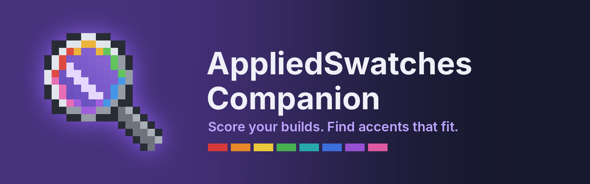

An addon for [AppliedSwatches](https://github.com/l0cks-acab/appliedswatches) (Applied Energistics 2) on NeoForge 1.21.1.

Point the **Swatch Lens** at a build and it shows how the build reads: its contrast, where its visual weight sits, how its palette is split and whether anything breaks the pattern. It then suggests accent blocks that fit, straight from your ME network.

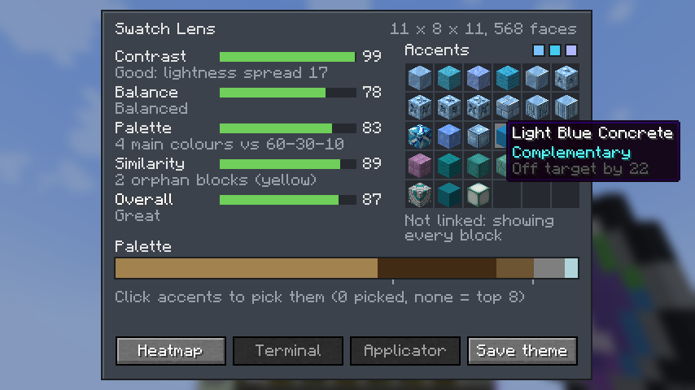

## Swatch Lens

| Action | What it does |
| --- | --- |
| Sneak + use on a Swatch or Theme Terminal | Links the lens to that terminal's ME network |
| Sneak + use on a block | Sets corner A (cyan) |
| Use on a block | Sets corner B (pink) |
| Use in the air | Scans the region and opens the results |
| Sneak + use in the air | Clears the corners and the heatmap |

While you hold the lens, the region shows as a purple box. Each side can be up to 64 blocks long, and the box turns red if it's too big.

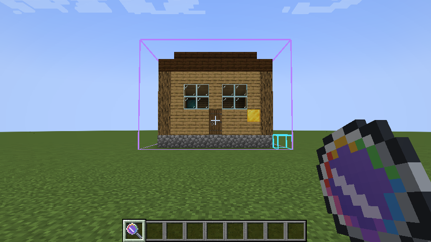

The results screen gives five scores from 0 to 100, each with a short verdict:

- **Contrast**: whether lightness varies enough to show shape, without jumping between extremes.
- **Balance**: whether the visual weight sits centred and slightly low.
- **Palette**: how close the colour split is to the 60-30-10 rule.
- **Similarity**: how many one-off blocks break the pattern.
- **Overall**: the average of the four, or of all five with the Surroundings Module.

The palette bar below the scores shows each colour group's share of the surface, with ticks at 60% and 90%. Hover a segment to see its hex code and share.

## Heatmap

**Heatmap** tints every visible face by visual weight, from blue (light) to red (heavy). The colours are scaled to the scan's own range, and orphan blocks get a yellow outline. Press it again on the next scan, or sneak + use in the air, to turn it off.

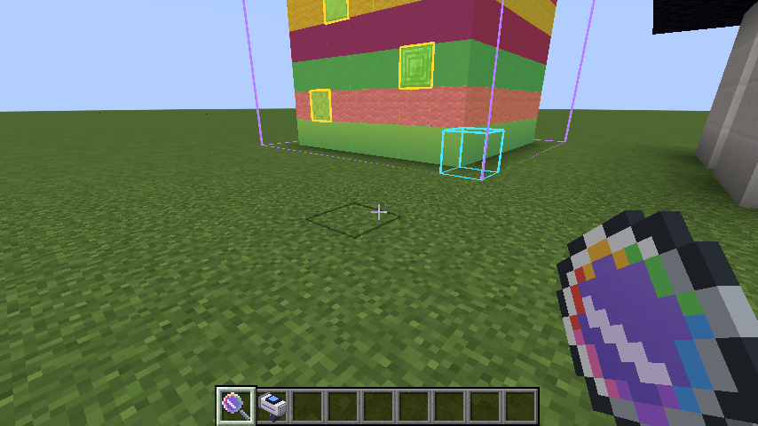

## Accents

Accents come in two modes, toggled by the button next to "Accents":

- **Harmony** (default): blocks that belong with the build's own palette. Each palette colour gets a darker shade, a lighter tint and a muted tone at the same hue. Greys fill big lightness gaps between colours, so a black, white and red build gets charcoal, greys and maroons.
- **Contrast**: colours complementary and split-complementary to the main colour, for a deliberate pop.

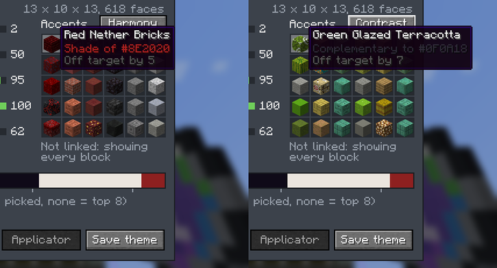

Candidates are full blocks the build doesn't already use, minus TNT and ores. When the lens is linked and its network is online, only blocks stored in the network are listed, with their amounts. Otherwise every block in the game is listed, minus machines. Hover an accent to see which palette colour it matches and how close it is.

Click accents to pick them. With nothing picked, the top 8 are used.

- **Terminal**: pulls 64 of each into the linked terminal's output slots, using the network's power.
- **Applicator**: loads them into your Swatch Applicator and links it to the terminal, ready to place.
- **Save theme**: saves the build's main colours plus the accents as an AppliedSwatches theme in `<game dir>/appliedswatches/themes/`, ready for the Theme Terminal.

Here are four builds: top-heavy black, white and red; a flat stone box; busy stripes; and a wooden house.

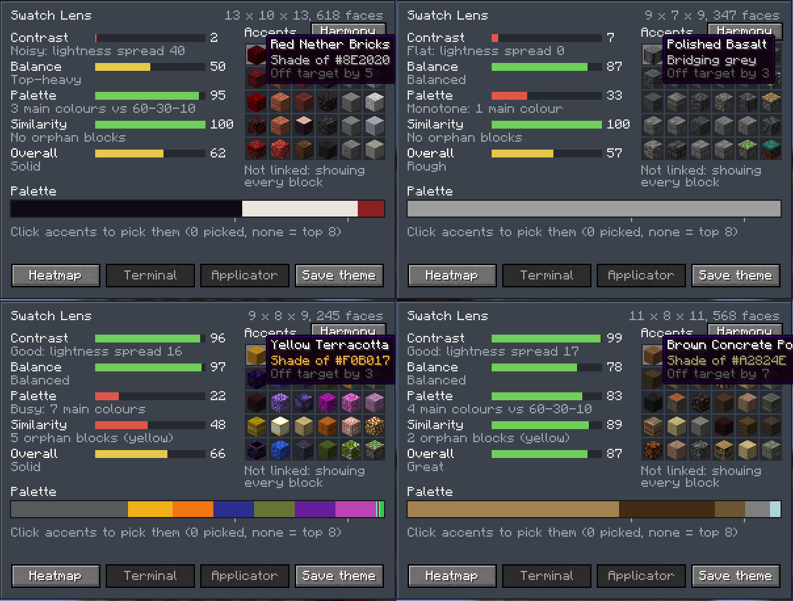

## Modules

Modules are cards that add features to the lens, like the upgrade cards in an AE2 terminal. The Lens screen has a module panel on its right with a slot for each one. Click an empty slot to install that module from your inventory, and click an installed one to take it out. You can also right-click a module onto the lens in any inventory.

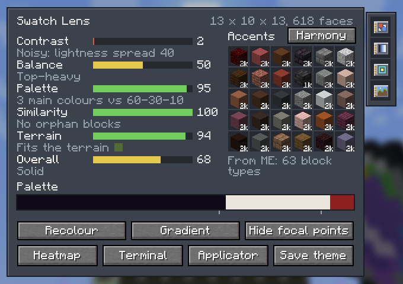

| Module | Recipe (shapeless) | What it adds |
| --- | --- | --- |
| Recolour | Advanced card, formation core, annihilation core | Swaps one block across the build, paid for from ME |
| Gradient | Basic card, white dye, black dye | Builds a block gradient between two colours from ME |
| Focal Point | Basic card, glow ink sac | Outlines plain areas that could use an accent |
| Surroundings | Basic card, compass | Scores how the build's colours fit the terrain around it |

### Recolour

Pick a block from the build at the top, then its replacement from the network below (searchable, sorted round the colour wheel), and press **Recolour**. Every block of that type in the region is swapped, along with its stairs, slabs and walls when both blocks have them. Facing, halves and other block properties carry over. The new blocks come out of the ME network and the old ones go back in, so the network needs enough of the new block. If it's short on a matching stair, slab or wall, those are left as they were.

**Undo last** puts your last recolour back, again through the network. The lens needs to be linked to an online network.

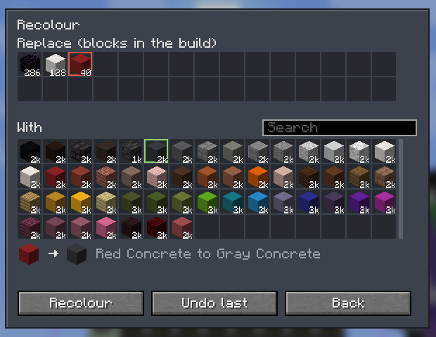

### Gradient

Left-click a block to start the gradient and right-click one to end it, then set 3 to 9 steps. The steps in between are the closest blocks to evenly spaced CIELAB colours between the two ends, each block used once. It starts from the build's darkest and lightest main colours. Send the ramp to the terminal or load it into a Swatch Applicator in order.

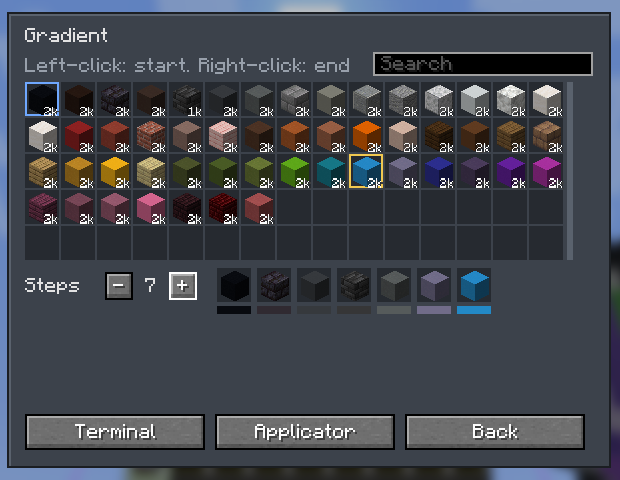

### Focal points

**Focal points** outlines flat areas of one block, at least 3 x 3 faces, whose visual weight is in the light half of the scan's range. These are the stretches an eye slides over. The filled face in the middle of each one is where an accent would draw the eye. Up to 12 are shown, biggest first.

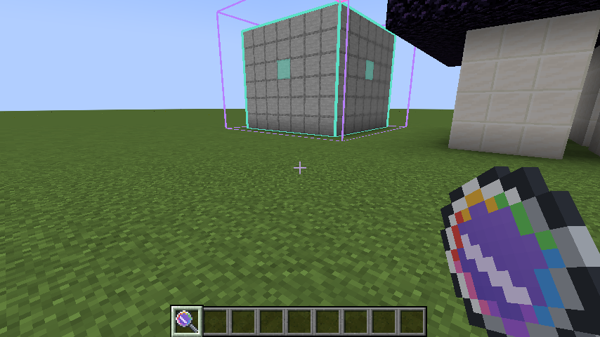

### Surroundings

Adds a **Terrain** score. The lens samples the top block of every column in a 16-block ring around the region, groups those colours, and checks each of the build's main colours against the closest terrain colour by hue and chroma. Lightness is ignored, since a pale house on dark grass is fine. Greys, black and white fit anywhere. Hover the score to see the terrain's colours.

## Details

Lens recipe (shaped): fluix crystal on top, glass on each side of a spyglass, amethyst shard below.

Requires Minecraft 1.21.1, NeoForge 21.1+, AE2 19.0.27 or newer and AppliedSwatches 0.2.3 or newer. Install on both client and server.

Scanning runs on the client, so resource packs change the colours, just like in AppliedSwatches. The server only lists the network's stock and handles exports.

Building: run `./gradlew build`. AppliedSwatches isn't on a public maven yet, so its release jar is in `libs/`.

## FAQ: the theory behind the scores

**1. What does the Lens actually look at?**
It looks at every block face in the region that you could see, meaning faces touching air or a see-through block. Faces pressed against another block are skipped. Each face gets the average colour of its texture, the pixels you see in game with tints applied, converted to CIELAB, the colour space AppliedSwatches uses. It also gets a **busyness** value: how much lightness varies across the texture's pixels. Cobblestone is busy and concrete is calm.

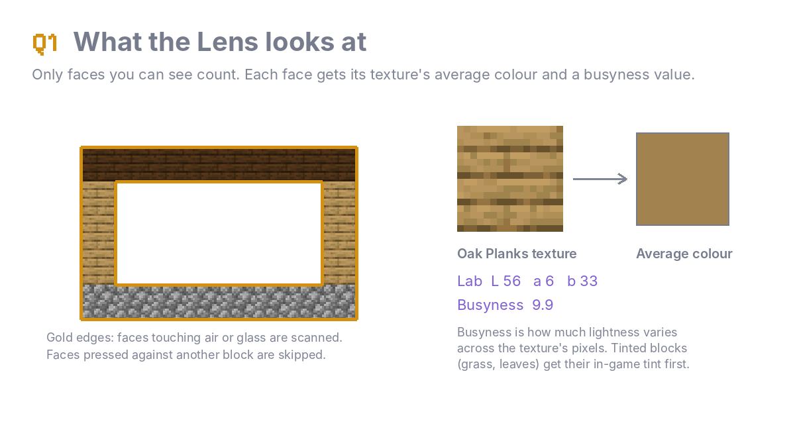

**2. What is visual weight?**
Painters and designers talk about elements that pull the eye harder than others. Dark colours, strong saturated colours and detailed textures all feel heavier than pale, grey, plain ones. The Lens gives every face a weight from 0 to 1:

weight = 0.5 × darkness + 0.3 × saturation + 0.2 × busyness

Darkness is (100 − L) / 100, saturation is CIELAB chroma / 60, and busyness is lightness spread / 20, each capped at 1. Snow weighs almost nothing and obsidian and red concrete weigh the most. The heatmap shows these values.

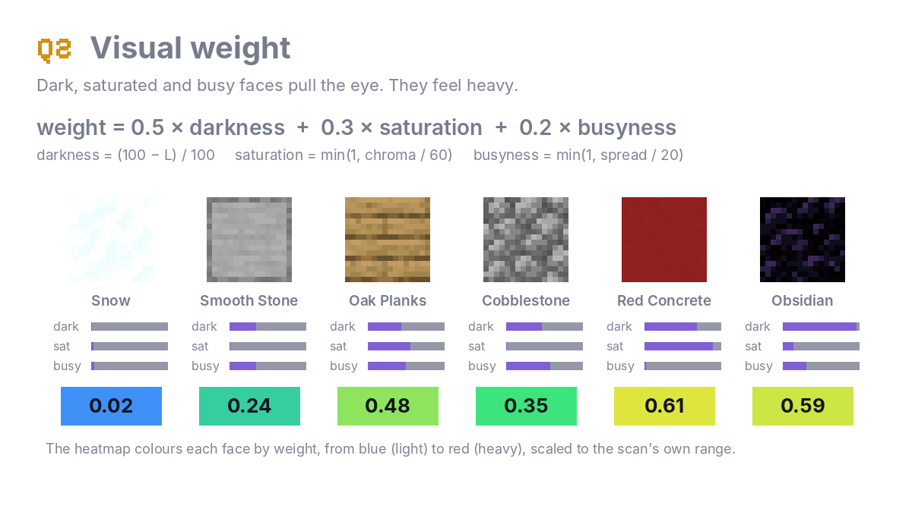

**3. How is contrast scored?**
Contrast is the standard deviation (σ) of lightness (L\*) over all visible faces. Your eye reads shape from light and dark, so a build with no spread looks flat, like a single grey blob. Too much spread, such as pure black against pure white, reads as harsh and noisy. The score is a bell curve centred on σ = 18:

score = 100 × e^−((σ − 18) / 11)²

A smooth stone box scores 7 (σ 0), a wooden house scores 99 (σ 17), and a black, white and red build scores 2 (σ 40).

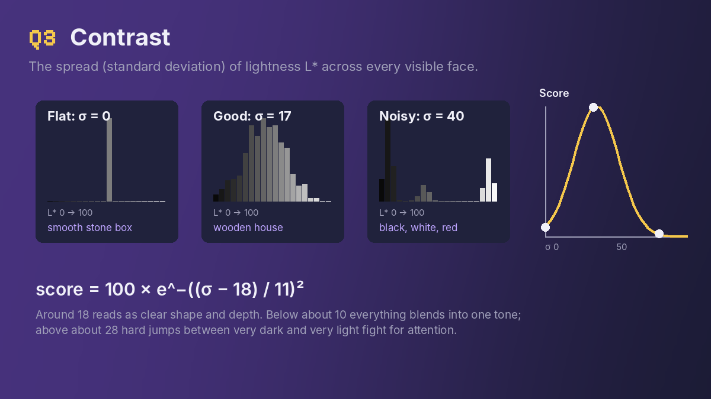

**4. How is balance scored?**
The Lens finds two points: the middle of all visible faces, and the **centre of weight**, the same average with each face counted by its weight. If they line up, the build feels stable. If the weight drifts sideways, the build feels like it leans. Weight sitting slightly low (8% below the middle) feels grounded, like a building on a solid base. Weight above the middle feels top-heavy, and that's penalised fastest. Sideways drift is measured as a share of half the build's width, with the full penalty at 35%.

score = 100 × (1 − ½ sideways penalty − ½ vertical penalty)

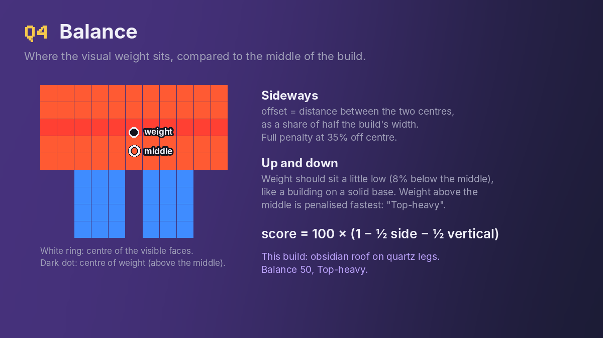

**5. What is 60-30-10?**
It's a classic interior design rule: 60% of a space in a main colour, 30% in a secondary colour and 10% in an accent. It works because the eye gets a clear base, some variety and one point of interest. The Lens groups face colours that are less than ΔE 18 apart (the same CIELAB distance AppliedSwatches uses), sorts the groups by share, and adds up how far each share is from 60, 30 and 10. Any extra groups count against the 0% they should be.

error = Σ |share − ideal|, score = 100 × (1 − error / 1.2)

A single group reads "Monotone", and more than five main groups (3% or more each) reads "Busy".

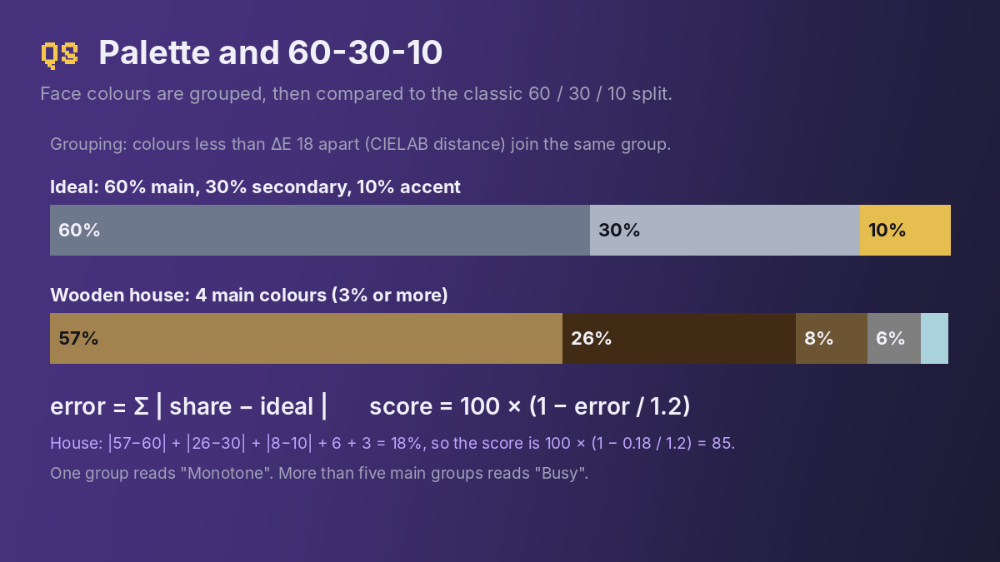

**6. What is Gestalt similarity?**
Gestalt psychology describes how we see groups before details. Its law of similarity says the eye groups things that look alike and treats them as a pattern. A single odd block with nothing like it nearby stands out as a mistake rather than a choice. The Lens counts **orphans**: block types used only once or twice in the scan, with no block of the same type in the 26 blocks around them. Repeating an accent in a rhythm, or grouping copies together, turns it back into a pattern. Builds under 20 blocks aren't judged.

score = 100 × (1 − 20 × orphans / blocks)

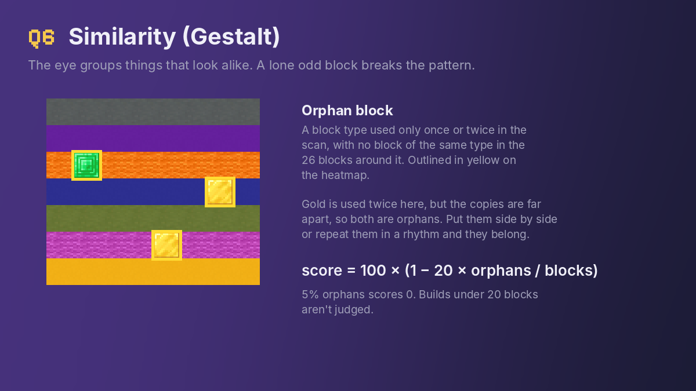

**7. How is the Terrain score worked out?**
Terrain colours come from the top face of every loaded column within 16 blocks of the region, grouped the same way as the build's palette (groups under 5% are dropped). For each of the build's main colours with chroma 12 or more, the Lens finds the nearest terrain colour using CIE94 with the lightness term removed:

d = √( (ΔC / (1 + 0.045 C))² + (ΔH / (1 + 0.015 C))² )

A colour's fit is e^−(d / 25)², and the score is the share-weighted average of those fits, with neutral colours counting as a perfect fit. A red brick house in a spruce forest sits near the brown of the logs and scores well. A blue house in a desert has nothing near it and scores low.

**8. How are Harmony accents picked?**
A good accent usually comes from colours the build already has. For each palette colour (with some chroma), the Lens makes three targets at the same hue: a **shade** (18 L darker), a **tint** (16 L lighter) and a **muted** tone (half the chroma). Neutral **bridging greys** fill lightness gaps of 22 or more between palette colours. So a black, white and red build gets maroons and red-browns from the red, and charcoal and stone greys between black and white.

Blocks are matched to targets with **CIE94**, a newer ΔE formula than AppliedSwatches' ΔE76. It weighs differences in hue more than differences in lightness, so a wrong colour costs more than a slightly wrong brightness:

ΔE94 = √( ΔL² + (ΔC / (1 + 0.045 C))² + (ΔH / (1 + 0.015 C))² )

A block is suggested if it's within ΔE94 22 of its closest target and isn't nearly identical to a colour already in the build. Targets take turns in the list, so every palette colour gets a few matches near the top. Contrast mode skips all this and uses the complementary hues instead.

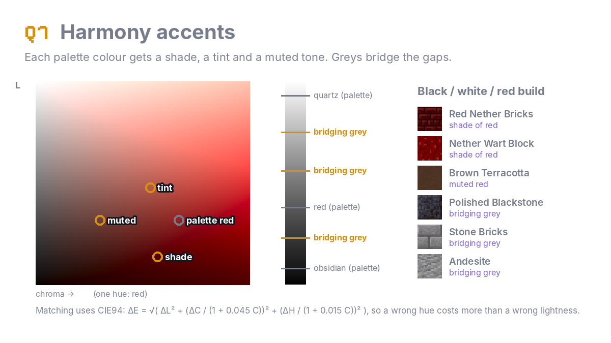
