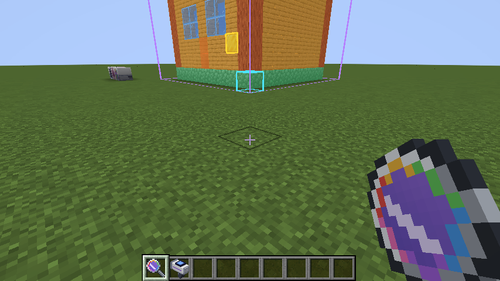

# AppliedSwatches Companion

An addon for [AppliedSwatches](https://github.com/l0cks-acab/appliedswatches) (and so Applied Energistics 2) on NeoForge 1.21.1.

Point the **Swatch Lens** at a build and it tells you how it reads: contrast, visual weight, palette and pattern. It also suggests accent blocks from your ME network that would make the build pop.

Harmony accents on four builds (top-heavy black/white/red, flat stone, busy stripes, wooden house):

## Swatch Lens

| Action | What it does |
| --- | --- |
| Sneak + use on a Swatch or Theme Terminal | Links the lens to that terminal's ME network |
| Sneak + use on a block | Sets corner A |
| Use on a block | Sets corner B |
| Use in the air | Scans the region (each side up to 64 blocks) |
| Sneak + use in the air | Clears the corners and the heatmap |

While you hold the lens, the region shows as a purple box (red if it's too big).

Recipe: fluix crystal on top, glass on each side of a spyglass, amethyst shard below.

## Scores

Only faces you can actually see count, meaning faces exposed to air or to see-through blocks. Every face's colour comes from its texture, using the same CIELAB approach as AppliedSwatches, but worked out per face.

- **Contrast**: the spread of lightness (L*) across the surface. Too little reads flat, too much reads noisy.
- **Balance**: where the visual weight sits. Dark, saturated and busy (high-detail) faces count as heavy. Weight should sit near the middle sideways and a little low, because top-heavy builds feel off.
- **Palette**: face colours grouped by colour distance and compared to the 60-30-10 rule. The palette bar shows each group's share, with ticks at 60% and 90%.
- **Similarity**: one-off blocks with no matching neighbour break the pattern (Gestalt similarity). They're outlined in yellow on the heatmap.
- **Overall**: the average of the four.

## Heatmap

Tints every visible face by visual weight, from blue (light) to red (heavy), scaled to the scan's own range.

## Accents

Two modes, toggled by the button beside "Accents":

- **Harmony** (default): blocks that belong with the build's own palette. Each palette colour gets a darker shade, a lighter tint and a muted tone at the same hue. Greys bridge big lightness gaps between colours, so black, white and red gets charcoal, greys and maroons.
- **Contrast**: complementary and split-complementary to the main colour, for a deliberate pop.

Matches use CIE94 distance, so hue counts for more than lightness. Each palette colour takes turns, so every one gets a few matches near the top. Candidates are full blocks the build doesn't already use, without TNT or ores. When the lens is linked and online, only blocks stored in the ME network are listed, with amounts. Otherwise every block in the game is listed, minus machines. Hover over an accent to see which palette colour it matches.

Click accents to pick them. With nothing picked, the top 8 are used.

- **Terminal**: pulls 64 of each into the linked terminal's output slots.
- **Applicator**: loads them into your Swatch Applicator and links it to the terminal.
- **Save theme**: saves the build's main colours plus the accents as an AppliedSwatches theme (`appliedswatches/themes/`), ready to load in the Theme Terminal.

## Building

`./gradlew build`. AppliedSwatches isn't on a public maven yet, so its release jar is in `libs/`.
